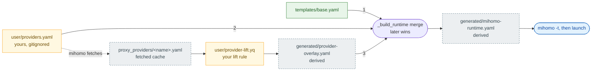

# mihomo

`~/.config/mihomo` is mihomo's home directory. The configuration is carried by
role: a publishable base, two files that are yours alone, and two rebuilt at
every start.

## How the config is built

`startproxy` calls `_build_runtime`, which merges the three inputs in that order
(later wins), writes the runtime config, then hands it to `mihomo -t` before
anything is launched. Green is committed, amber is yours, dashed grey is rebuilt
on every start.

## Files

| path | owner | |
| --- | --- | --- |
| `templates/base.yaml` | committed | publishable defaults — ports, TUN, `dns:`, `proxy-groups`, `rules:`. No secrets, no airport. |
| `user/providers.yaml` | **yours, gitignored** | your subscriptions. Every secret lives here. |
| `user/provider-lift.yq` | **yours, gitignored** | the yq program deciding which keys of a subscription's config are lifted. Copied from `templates/provider-lift.example.yq`. |
| `generated/provider-overlay.yaml` | derived | the keys the lift rule lifted out of a subscription; merged last. |
| `generated/mihomo-runtime.yaml` | derived | what mihomo is launched with. Rebuilt every start — **edits here are lost.** |

`proxy_providers/` (fetched nodes), `rules/` (fetched rule providers), `ui/` (the
dashboard, downloaded on first start) and `cache.db` (selection and fake-ip state)
belong to mihomo. Leave them alone.

**`user/providers.yaml` holds your subscription URL, which carries a personal token.
Never commit it, screenshot it or paste it into an issue** — it is gitignored for
exactly that reason.

## Commands

`~/.zshrc` sources the helper, so a new zsh has these. In any other shell:
`source ~/.config/mihomo/mihomo-api.sh`.

| command | |
| --- | --- |
| `startproxy` | Build, then start. Asks for sudo. Refuses to start a second mihomo. Returns 0 only when every check has passed. |
| `stopproxy` | Stop mihomo; on macOS, reset system DNS. |
| `statusproxy` | Re-check a live proxy: process, controller, a blocked site through `:7890`, the dashboard, and (macOS) the DNS pointer. Each probe lets curl retry while mihomo settles. Idempotent; non-zero on any failure. |
| `setproxy` / `unsetproxy` | Export / unset the proxy environment variables **in this shell only**. |

Set these in `mihomo-api.sh` (committed). Only `MIHOMO_HOME` is read from your
environment — export it before sourcing to move the whole config tree.

| variable | default | |
| --- | --- | --- |
| `MIHOMO_HOME` | `~/.config/mihomo` | where every path is rooted |
| `MIHOMO_PROXY_URL` | `http://127.0.0.1:7890` | what `setproxy` exports |
| `MIHOMO_NETWORK_SERVICE` | `Wi-Fi` | macOS only, and hardcoded — wrong wherever the active service is named otherwise |

Dashboard: <http://127.0.0.1:9090/ui/>

## Where a setting goes

`startproxy` merges three documents, in order: `templates/base.yaml`, then
`user/providers.yaml`, then `generated/provider-overlay.yaml` (produced by
`user/provider-lift.yq`). Later wins.

> **Maps merge key by key. Lists replace wholesale.** Your own `rules:` or
> `nameserver:` does not extend the base's — it replaces it.

| I want to | edit | restart? | |
| --- | --- | --- | --- |
| change something shared — port, TUN, `rules:`, groups | `templates/base.yaml` | yes | committed, so it applies on every machine |
| add or change a subscription | `user/providers.yaml`, `proxy-providers:` | yes | one block per subscription; the block is annotated in `templates/providers.example.yaml` |
| change which keys are lifted out of a subscription | `user/provider-lift.yq` | yes | yours; the example is `templates/provider-lift.example.yq` |
| change DNS | see below | yes | |
| discard derived state | `rm -rf generated/` | yes | rebuilt on the next start |

## DNS

`templates/base.yaml` sets the default `dns:` (`doh.pub`, `alidns`). The lift rule
may replace part of it with the subscription's own — notably `nameserver`, the
only resolver that answers for the airport's node domains. The cost: the airport
then sees every domain you resolve, and its resolver going down takes your general
DNS down with it. Drop `dns.nameserver` from `user/provider-lift.yq` if you would
rather keep the base's resolvers.

Before the subscription has ever been fetched there is nothing to lift, so the
base `dns:` answers and `startproxy` prints `lift: nothing - no provider cache
yet`.

## Troubleshooting

| you see | run | then |
| --- | --- | --- |
| `mihomo has already started.` / `mihomo is not running` | `pgrep -x mihomo` | you are out of step with reality: `stopproxy; startproxy`. After a crash macOS DNS may still point at mihomo, which just looks like no DNS: `sudo networksetup -setdnsservers Wi-Fi Empty` |
| `Error: providers file not found at …` | — | `cp templates/providers.example.yaml user/providers.yaml`, then fill in the URL |
| `Error: lift rule not found at …` | — | `cp templates/provider-lift.example.yq user/provider-lift.yq` |
| `Error: lift rule … failed on …` | `yq --from-file user/provider-lift.yq <cache>` | the yq error it hid; fix the rule you just edited |
| `Error: runtime config failed 'mihomo -t'; not starting.` | the validator output printed under it | fix the file you just edited; `startproxy` re-checks |
| `status: FAIL - API controller not responding` | `curl -fsS 127.0.0.1:9090/version` | `stopproxy; startproxy`; still failing, read the validator output it prints |
| `status: FAIL - blocked site not reachable through …:7890` | `stopproxy; startproxy`, then the dashboard at `:9090/ui/` | the nodes are usually at fault, not the proxy — check health and the selected group |
| `status: FAIL - dashboard not served` | `ls ui/` | the `external-ui-url` download failed; delete `ui/` and restart |
| `status: FAIL - system DNS not pointed at 198.18.0.2` | `scutil --dns \| grep 198.18` | wrong `MIHOMO_NETWORK_SERVICE` (hardcoded `Wi-Fi`); fix it and restart |
| `lift: nothing - no provider cache yet` | — | not a failure; `stopproxy; startproxy` once the subscription has been fetched |
| `startproxy` fails and gives no reason | `lsof -nP -iTCP:7890 -sTCP:LISTEN` | mihomo's launch output is discarded, so a port already in use is silent; free `7890`, or move `mixed-port` and `MIHOMO_PROXY_URL` |
| a tool ignores the proxy | `env \| grep -i proxy` | `setproxy` only affects the shell it ran in — run it there, or rely on TUN |

Never debug by editing `generated/`: `stopproxy; startproxy` rebuilds it from the
files you own.

## Further reading

- [`README.md`](../../../README.md) §Phase 4 — provisioning a new machine from nothing, with checks.
- `templates/providers.example.yaml` — a copy-paste subscription block, annotated field by field.
- `templates/provider-lift.example.yq` header — the in/out contract: which keys the example lifts, and which it never reads.
